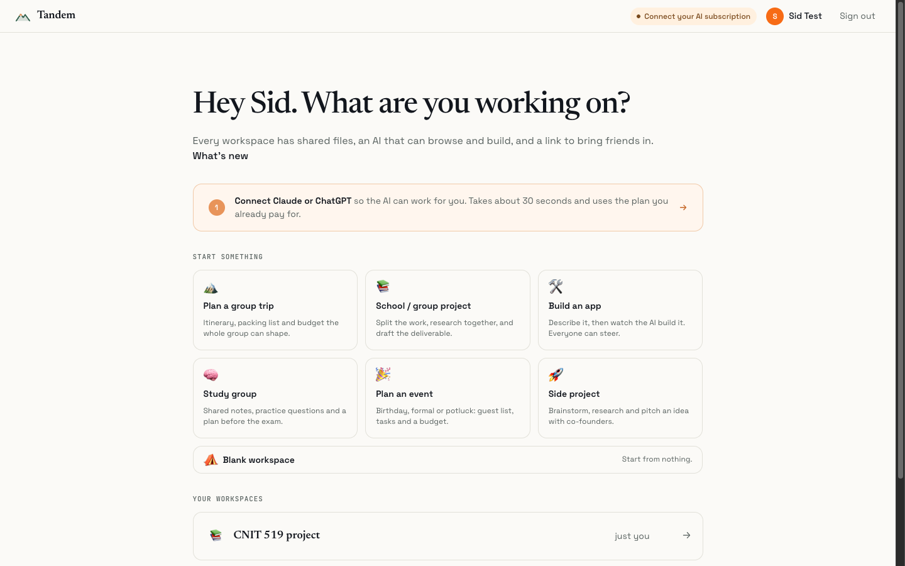
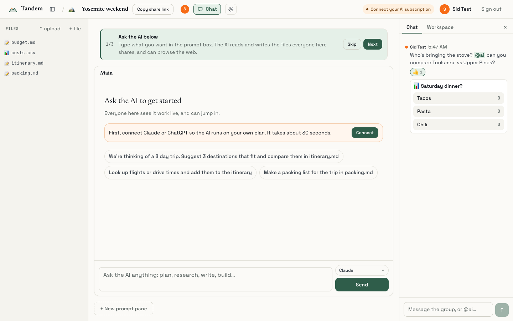
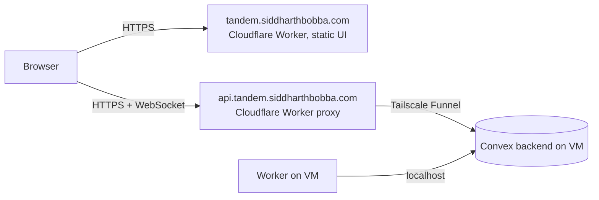
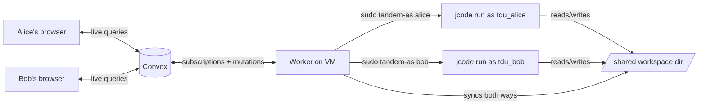

# Tandem

**Your group's shared AI workspace.** Plan the trip, finish the project, build the thing, together. Everyone in a workspace shares files, a team chat and an AI that researches, writes, browses and builds while the whole group watches and steers it live.

Each person's prompts run through the [Jcode](https://github.com/1jehuang/jcode) agent harness **on that person's own AI subscription** (Claude Pro/Max or ChatGPT Plus/Pro), connected once in Settings. A friend joining from their laptop uses their subscription, not yours. No new AI bill.

**Live:** https://tandem.siddharthbobba.com · Built on [Convex](https://convex.dev) (self-hosted, with Convex Auth), React and a small Node worker.


## What you can do

- **Start from a template:** trip, school project, study group, event, side project, app, or blank. Each one seeds starter files, AI instructions and suggested prompts.
- **Ask the AI together.** Everyone sees it work live, can steer it mid-task, and finished runs fold their steps under one line so the answer stands out. Every change it makes has a diff and can be undone, file by file.
- **The AI can browse.** It drives a real browser and everyone watches the frames live.
- **Shared files:** a code editor with live HTML preview, markdown and CSV table previews, PDF, image and video viewers, paste from Google Docs as markdown, and zip export. Publish any doc as a clean public page.
- **Team chat:** `@ai` hands the AI a task, plus @mentions, replies, reactions, polls, a typing indicator and desktop notifications.
- **Bring people in:** share links open a welcome card ("Maya invited you to Yosemite weekend") with a look-around mode, and use the phone's share sheet on mobile. "While you were away" tells you what changed since your last visit.
- **Polish:** Cmd+K palette, `?` shortcuts, first-run tour, works on phones, installable (PWA), WCAG AA contrast, and a landing page that loads without the app bundle.

| Home | Team chat |
|---|---|
|  |  |

## Architecture



The UI is static files on Cloudflare. API traffic goes through a small Cloudflare Worker (`deploy/api-proxy`) to the self-hosted Convex backend, which is exposed only through Tailscale Funnel. The agent worker talks to Convex over localhost, so nothing else on the VM is reachable from the internet.


## How it works



1. Someone signs in (Convex Auth, email + password) and types a prompt. A mutation inserts a `runs` row tied to their user id. The author name comes from their account, not the client.
2. The worker holds a live subscription on queued runs, so Convex pushes the new run to it immediately.
3. The worker claims the run in a transactional mutation that also returns **the prompter's** saved provider, model, sandbox key and conversation id. One prompt per pane at a time, and a run is never claimed twice.
4. The worker runs `jcode run --ndjson` as that person's own Linux user (`tdu_<key>`) in the shared workspace directory, and turns each event (text, shell command, file edit) into an `events` row. Every viewer re-renders live, with a tag showing whose subscription it ran on.
5. Agent file writes get mirrored into the `files` table. Browser edits set `pendingWrite`, and the worker writes them to disk.
6. Context is kept per (pane, person): each person's follow-ups resume their own Jcode session.

### Accounts and saved configuration

The `profiles` table holds each account's display name, color, default subscription (Claude or ChatGPT) and optional model override. Settings save instantly and follow you to any device.

To connect a subscription, Settings creates a `loginFlows` row. The worker runs `jcode login <provider> --print-auth-url` **inside that person's sandbox** and puts the sign-in URL back in the row. The person approves it in their own browser and pastes the code (Claude) or final URL (ChatGPT) back. The worker finishes the login in their sandbox and clears the code from the database. Tokens never touch Convex. Only a `connections` status row does.

### Isolation

`deploy/tandem-as` is a small root-owned launcher, the only thing the worker can `sudo`. It:

- creates one system user per account on first use, with a `0700` home that holds that person's Jcode credentials and sessions
- only runs `jcode`, only with a working directory inside `/srv/tandem/workspaces`, and clears the environment
- drops all capabilities
- keeps every workspace directory private: no group or other access, plus an ACL entry per member, added when that member's run is claimed. An agent can only touch workspaces its owner belongs to, and nobody can list the workspace root

An `nftables` rule (`deploy/setup-vm.sh`) blocks sandbox users from loopback services and private networks, apart from DNS. `tests/accounts.mjs` checks all of this against the live VM: a sandbox user can't read another user's credentials, a workspace it isn't a member of, the operator's home, or the Convex admin key, and can't reach Convex on localhost. It can still reach the public internet and its own workspaces.

## Why Convex fits

| Need | Convex piece |
| --- | --- |
| Accounts, sessions | Convex Auth (`convex/auth.ts`) |
| Per-user saved config | `profiles`, `connections` tables |
| Live agent output for every viewer | reactive `useQuery` on `paneFeed` |
| Job queue for prompts and logins | `runs`, `loginFlows` plus worker subscriptions |
| No double-claimed jobs | transactional `claim` mutation |
| Membership and invites | `members` table, `requireMember` in every function |
| Shared file tree | `files` (metadata) and `contents` tables, live |
| Who's online | `presence` table |
| Cleanup | cron in `convex/crons.ts` |

Convex can't run processes. The agent needs a real shell, a filesystem, and per-user OS isolation, so that part lives in the worker on a VM. Convex is the coordination layer.

## Layout

```
convex/      schema, auth, and functions (workspaces, files, presence, profile, worker API)
src/         React UI (sign-in, workspaces, settings/connect, panes, editor)
worker/      Node worker: runs jcode per user, drives logins, syncs files
deploy/      VM setup: tandem-as launcher, sudoers, firewall
tests/       live end-to-end suites
```

## Run it

```bash
# 1. backend (self-hosted Convex), exposed at https://HOST:10000, HTTP actions at :10002
./convex-local-backend --interface 127.0.0.1 --port 3310 --site-proxy-port 3311 \
  --instance-name tandem --instance-secret <secret> \
  --convex-origin https://HOST:10000 --convex-site https://HOST:10002
./convex-local-backend keygen admin-key --instance-name tandem --instance-secret <secret>

# 2. functions + auth keys
echo "CONVEX_SELF_HOSTED_URL=http://127.0.0.1:3310" > .env.local
echo "CONVEX_SELF_HOSTED_ADMIN_KEY=<admin key>" >> .env.local
npm install
npx convex env set WORKER_SECRET <random>
npx convex env set SITE_URL https://HOST:10001
npx convex env set JWT_PRIVATE_KEY -- "<RS256 PKCS8, newlines as spaces>"
npx convex env set JWKS '<{"keys":[...]}>'
npx convex deploy

# 3. VM sandboxing (Linux, once)
sudo JCODE_BIN=/path/to/jcode WORKER_USER=$USER bash deploy/setup-vm.sh

# 4. worker
WORKER_SECRET=<random> CONVEX_URL=http://127.0.0.1:3310 npm run worker

# 5. UI
VITE_CONVEX_URL=https://HOST:10000 npm run build   # serve dist/
```

I run the backend, worker and UI as systemd user services on an Oracle ARM VM, exposed over Tailscale only.

## Testing

All suites run against a live deployment:

```bash
export CONVEX_URL=https://api.tandem.siddharthbobba.com UI_URL=https://tandem.siddharthbobba.com WORKER_HOST=your-vm WORKSPACES_DIR=/srv/tandem/workspaces
node tests/translator.mjs             # 9: replays real captured jcode runs through the worker (offline)
node tests/accounts.mjs               # 14: auth, saved settings, membership, per-user sandbox + isolation, connect flow
node tests/smoke.mjs                  # 8: API, path validation, file sync, queueing, presence
node tests/codex/tandem-e2e.mjs       # 10: adversarial checks, written by Codex
node tests/workspace-features.mjs     # 9: templates, chat + @ai, change log + undo, publish, browse cap
node tests/multiplayer-ui.mjs         # 18: two real headless browsers: presence, live editing, chat, invite flow, editor, CSV, menus
node tests/security.mjs               # signed-out / non-member probes on every member-only endpoint
node tests/boot.mjs                   # landing loads without the app; signed-in users skip it
node tests/a11y.mjs                   # axe-core audit of 6 pages (0 serious/critical)
node tests/load.mjs                   # burst across many workspaces, concurrency cap
```

Checks that need a model to answer (agent writes files, streaming, follow-up context, cancel, load) sign in with a connected account from `TANDEM_TEST_EMAIL` / `TANDEM_TEST_PASSWORD` and are skipped without one. Everything else always runs.

## Limits

- Members of a workspace can make agents run shell commands as their own sandbox user, and that user can reach the internet. The agent browser is capped at 200 actions per person per day.
- A member's agent can edit any file in the workspaces they belong to (that's the point of sharing). Every AI change can be undone.
- Text files are mirrored up to 400 KB; images, PDFs and other binaries up to 20 MB go through Convex storage. `node_modules`/`.git` are not mirrored.
- File edits are last-write-wins, not character-level merging.
- No email verification or password reset.
- Self-hosted Convex on a small, shared VM. Password hashing needed `DATABASE_UDF_USER_TIMEOUT_SECONDS=5` (the default is 1s) to stay reliable under load.
