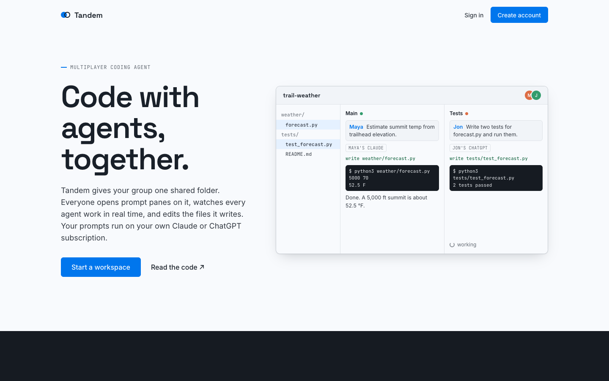
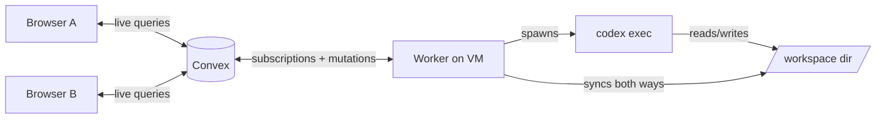

# Tandem

A multiplayer coding agent. Think Google Drive folder plus a terminal: everyone with the link shares one project directory, opens as many prompt panes as they want, and watches every agent's output stream in live. Files the agents write show up in the sidebar instantly, and anyone can edit them in the browser.

Built on [Convex](https://convex.dev) (self-hosted) with React and a small Node worker that drives the Codex CLI.



## How it works



1. Someone types a prompt. A mutation inserts a `runs` row with status `queued`.
2. The worker holds a live subscription on queued runs, so Convex pushes the new run to it immediately (no polling, no queue service).
3. The worker claims the run in a mutation. Convex mutations are serializable transactions, so a run is never picked up twice, and each pane runs one prompt at a time.
4. The worker spawns `codex exec --json` in that workspace's directory and turns each agent event (message, shell command, file change) into an `events` row. Every browser subscribed to the pane re-renders as rows land.
5. Agent file writes get mirrored into the `files` table. Browser edits set `pendingWrite`, the worker sees them through another subscription and writes them to disk.
6. Each pane stores its Codex thread id, so follow-up prompts keep context.
7. Presence (avatars, who is looking at which pane) is a heartbeat mutation plus a query.

## Why Convex fits

Almost everything here is "shared state that many clients need to see change live." Normally that means Postgres, a websocket server, a job queue, and cache invalidation. With Convex it's queries and mutations:

| Need | Convex piece |
| --- | --- |
| Live agent output for every viewer | reactive `useQuery` on `paneFeed` |
| Job queue for prompts | `runs` table plus worker subscription |
| No double-claimed jobs | transactional `claim` mutation |
| Shared file tree | `files` table, live |
| Who's online | `presence` table |

What Convex doesn't do: run arbitrary processes. The agent needs a real shell and filesystem, so that part lives in the worker on a VM. Convex is the coordination layer.

## Layout

```
convex/      schema and functions (workspaces, files, presence, worker API)
src/         React UI
worker/      Node worker that runs codex and syncs files
```

## Run it

Self-hosted backend (or swap in a Convex cloud deployment):

```bash
# backend
./convex-local-backend --port 3310 --site-proxy-port 3311 --instance-name tandem --instance-secret <secret>
./convex-local-backend keygen admin-key --instance-name tandem --instance-secret <secret>

# functions
echo "CONVEX_SELF_HOSTED_URL=http://127.0.0.1:3310" > .env.local
echo "CONVEX_SELF_HOSTED_ADMIN_KEY=<admin key>" >> .env.local
npm install
npx convex env set WORKER_SECRET <random>
npx convex deploy

# worker (needs codex CLI logged in)
WORKER_SECRET=<random> CONVEX_URL=http://127.0.0.1:3310 npm run worker

# UI
VITE_CONVEX_URL=https://your-backend npm run build   # serve dist/
```

I run all three as systemd user services on an Oracle ARM VM, exposed over Tailscale only.

## Testing

All suites run against a live deployment and drive real agent runs:

```bash
export CONVEX_URL=https://your-backend UI_URL=https://your-ui WORKER_HOST=your-vm WORKSPACES_DIR=/home/you/tandem-workspaces
node tests/smoke.mjs                  # 7 API checks
node tests/codex/tandem-e2e.mjs       # 10 adversarial checks, written by Codex
node tests/multiplayer-ui.mjs         # 6 checks with two real headless browsers
node tests/load.mjs                   # 16 runs across 8 workspaces at once
node tests/codex/ui-smoke.mjs <workspaceId> [screenshot.png]
```

Coverage: concurrent panes, streaming before a run finishes, in-order queueing with no double runs, follow-up context, cancel (process actually killed), two-way file sync, path traversal, worker auth, pane deletion mid-run, unicode/long output, presence, live cross-browser editing (an unsaved draft is never clobbered), and a burst load that holds the concurrency cap. `tests/codex/REPORT.md` is the Codex QA report, including the bug it caught (deleting a running pane stranded the run), which is fixed.

Robustness:
- The worker runs at most `MAX_ACTIVE` agents (default 4). Extra prompts wait in the queue.
- When the worker starts, it marks runs left `running` by a dead worker as errored. A Convex cron (`convex/crons.ts`) cancels runs whose pane was deleted.
- File contents live in their own table, so the file tree query reads metadata only (a 14 MB workspace was pushing the 16 MB per-query read limit before this split). Pane feeds show the latest 30 runs.
- The worker reconnects on its own when the Convex backend restarts.

## Limits (it's a toy)

- No auth beyond a display name. Keep it on a private network. The agent runs with its sandbox off, so anyone with access can run shell commands on the box.
- Text files only, under 400 KB. Binary files and `node_modules`/`.git` are not mirrored.
- File edits are last-write-wins, not character-level merging.
